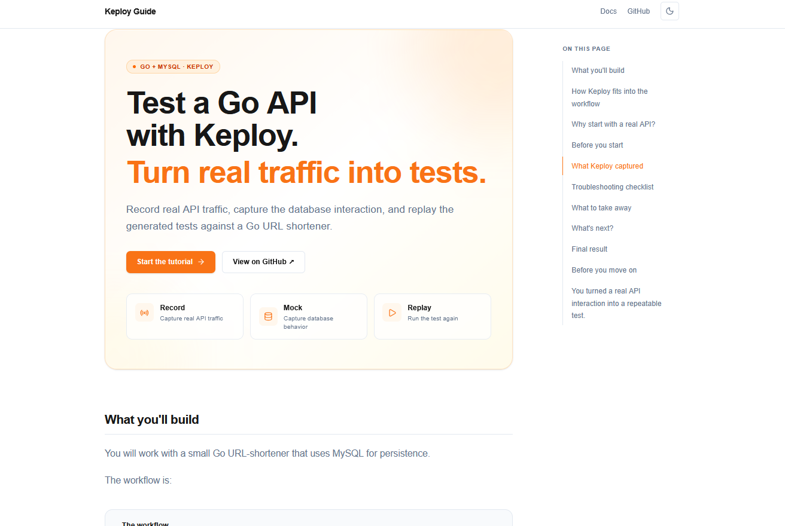

# Test a Go API with Keploy

A beginner-friendly documentation site that walks through a real Go + MySQL API testing workflow with Keploy.

The guide takes you from a running Go API to recorded API tests, database mocks, troubleshooting a real recording issue, and finally replaying the test set successfully.

## What this project demonstrates

* Recording real API interactions with Keploy
* Capturing database behavior as mocks
* Inspecting generated API tests and database mocks
* Diagnosing a failed recording caused by an HTTP `100 Continue` interaction
* Re-recording from a clean database state
* Replaying the recorded test set
* Building a static documentation site with Next.js and MDX

The completed workflow ended with **4 / 4 recorded tests passing**.

## Live Demo


## Screenshot




## Tech Stack

* Next.js 16
* TypeScript
* React
* App Router
* MDX
* Tailwind CSS
* `@tailwindcss/typography`
* `next-themes`
* `rehype-pretty-code`
* Shiki
* `remark-gfm`
* Lucide React

The site uses Next.js static export and has no runtime API or server-side application logic.

## Run Locally

### Prerequisites

Make sure you have:

* Node.js installed
* npm installed

### Install dependencies

```bash
npm install
```

### Start the development server

```bash
npm run dev
```

Open the local URL shown by Next.js in your browser.

### Create a production build

```bash
npm run build
```

The production site is generated as static output in the `out` directory.

To preview the exported site locally:

```bash
npx serve@latest out
```

## Project Structure

```text
src/
├── app/
│   ├── globals.css
│   ├── layout.tsx
│   └── page.mdx
│
├── components/
│   ├── back-to-top.tsx
│   ├── badge.tsx
│   ├── callout.tsx
│   ├── closing-section.tsx
│   ├── copy-code.tsx
│   ├── flow-diagram.tsx
│   ├── navbar.tsx
│   ├── reading-progress.tsx
│   ├── record-replay-diagram.tsx
│   ├── screenshot.tsx
│   ├── steps.tsx
│   ├── table-of-contents.tsx
│   ├── tabs.tsx
│   ├── theme-provider.tsx
│   └── theme-toggle.tsx
│
└── mdx-components.tsx

public/
└── images/
    └── screenshots used by the guide
```

## Documentation Features

The site includes:

* Light / Dark mode
* Reading progress indicator
* Sticky table of contents
* Heading navigation
* Responsive layout
* Copy buttons for code blocks
* Platform tabs
* Step-by-step workflow
* Record → mock → replay visual explanation
* Real terminal screenshots
* Click-to-enlarge screenshots
* Keyboard-accessible screenshot dialogs
* Back-to-top control
* Accessible focus states
* Static export for deployment

## What I Learned

This project reinforced that good technical documentation is not only about explaining the happy path.

The most useful part of the Keploy workflow was seeing what happens when the captured interaction and database state do not line up. Inspecting the generated test and database mock made the failure concrete and showed why replay behavior can differ from the original recording.

On the frontend side, the project was an opportunity to build a documentation experience rather than a traditional application: MDX content, reusable components, responsive layouts, accessible interactions, syntax highlighting, theme switching, and static deployment all working together.

## Validation

Before deployment, the project should pass:

```bash
npm run lint
npm run build
```

The production build uses:

```text
output: "export"
```

so the generated site can be deployed as static files.

## Deployment

The site is intended to be deployed on Vercel from the public GitHub repository.

After deployment, add the final Vercel URL to the **Live Demo** section above.

## Repository

This repository contains both the documentation source and the reusable UI components used to present the tutorial.
